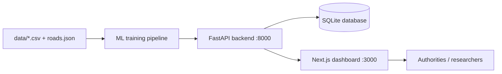

# AI-Based Disease Outbreak Prediction and Response Planner

An **academic end-to-end prototype** that predicts dengue high-incidence events one week in advance across 12 Indian cities, assesses severity, ranks regions for response, recommends actions, and shows shortest logistics routes through an interactive web dashboard.

## Dataset Sources

The project uses three datasets for disease surveillance, healthcare facility mapping, and regional population analysis.

- **Dengue Cases — `data/dengue_data.csv`:** National Centre for Vector Borne Diseases Control (NCVBDC), Government of India — https://ncvbdc.mohfw.gov.in/
- **Health Centers — `data/health_centers.csv`:** Ayushman Bharat Digital Mission, Health Facility Registry — https://facility.abdm.gov.in/
- **Regions and Population — `data/regions.csv`:** WorldPop — https://www.worldpop.org/

The datasets are intended to support dengue risk prediction, healthcare resource planning, and population-based regional analysis. Data coverage, reporting frequency, geographic resolution, and field availability depend on the selected source and dataset version.

## What It Does

- **Predicts:** Estimates the probability (0–100%) that each region enters a high-incidence event next week using a Random Forest trained on rolling and lag features, including cases, growth, rainfall, temperature, humidity, water accumulation, seasonality, and per-capita metrics.
- **Assesses severity:** Assigns LOW, MODERATE, HIGH, or CRITICAL severity based on probability, case load, growth, deaths, and geographic spread.
- **Ranks regions:** Calculates a weighted priority score using probability (50%), severity (30%), and population (20%) to support resource-allocation planning.
- **Plans a response:** Uses 13 rule-based actions matched to severity bands, each with a human-readable, value-filled justification.
- **Routes logistics:** Compares Dijkstra and A* algorithms over a demonstration road network containing 19 nodes and 27 edges.
- **Explains predictions:** Uses perturbation-based feature attributions to explain individual model predictions.

## Technology Stack

| Layer | Technology |
|---|---|
| Machine Learning | Python, scikit-learn, pandas, joblib, matplotlib |
| Backend | FastAPI, uvicorn, SQLite |
| Frontend | Next.js 16 App Router, TypeScript, Tailwind CSS, react-leaflet |
| Testing and Quality | pytest (19 tests), ESLint, `tsc --noEmit`, `next build` |

## Quick Start

### 1. Install dependencies

```bash
pip install -r backend/requirements.txt
npm install
cd frontend
npm install
cd ..
```

### 2. Train the machine learning model

```bash
npm run train
```

This trains the configured models and generates model artifacts and evaluation figures.

### 3. Seed the database

```bash
npm run seed
```

This initializes the SQLite database at `backend/demo.db`.

### 4. Run the application

```bash
npm run dev
```

Open the dashboard at **http://localhost:3000**.

The FastAPI backend is expected at **http://localhost:8000**, with interactive API documentation at **http://localhost:8000/docs**.

For environment variables, detailed instructions, and troubleshooting, see [docs/setup.md](docs/setup.md).

## Machine Learning Results

The following results are from the existing held-out test weeks.

| Model | Accuracy | Precision | Recall | F1 | ROC AUC | Role |
|---|---:|---:|---:|---:|---:|---|
| Logistic Regression | 0.737 | 0.324 | 0.918 | 0.479 | 0.901 | Baseline |
| Random Forest (balanced) | 0.884 | 0.536 | 0.918 | 0.677 | Evaluated variant |
| Random Forest (unweighted) | 0.922 | 0.778 | 0.571 | 0.659 | Serving model |

The unweighted Random Forest is the current serving model. Its reported metrics describe the existing evaluation and should be interpreted in the context of the dataset, event-label definition, class distribution, and test methodology.

Performance must be re-evaluated whenever the underlying data or label-generation process changes.

## Dashboard Pages

| Route | Content |
|---|---|
| `/dashboard` | National summary, critical alerts, interactive risk map |
| `/regions` | Region list, priority ranking, per-region case history |
| `/predictions` | Ranked predictions and explainability |
| `/predictions/[id]` | Severity factors and recommended actions for a region |
| `/response` | Recommended actions grouped by severity |
| `/routes` | Dijkstra versus A* logistics routing comparison |
| `/model` | ROC curves, confusion matrices, feature importance |
| `/data` | Raw dataset browser and dataset information |

Architecture diagram: [docs/architecture.md](docs/architecture.md)

## System Architecture



## Documentation

- [architecture.md](docs/architecture.md) — Components, data flow, and deployment
- [ml-methodology.md](docs/ml-methodology.md) — Features, labels, models, and evaluation metrics
- [response-planning.md](docs/response-planning.md) — Severity, priority, response actions, and routing
- [data-model.md](docs/data-model.md) — SQLite schema and data lifecycle
- [api-reference.md](docs/api-reference.md) — REST API endpoints
- [setup.md](docs/setup.md) — Installation, execution, verification, and troubleshooting

## Reproducibility

- `scripts/generate_data.py` regenerates the existing dataset deterministically.
- `npm run train` retrains the configured models and generates artifacts and figures.
- The database seed operation is designed to be idempotent.
- The backend reruns the prediction pipeline automatically on its first request.
- Git-ignored runtime files, including `backend/demo.db`, `ml/artifacts`, `ml/figures`, `node_modules`, and `.next`, can be rebuilt from the committed source and available datasets.

## Project Purpose and Limitations

This project is developed as an academic prototype for dengue risk analysis, response planning, and logistics optimization.

The dataset source portals provide starting points for acquiring relevant public data. Dataset provenance, licensing, geographic coverage, reporting frequency, and compatibility with the model's expected schema must be verified.

A high-incidence event is a project-defined prediction target and should not be interpreted as an official epidemiological outbreak definition.

The system is not medical software and must not be used for real-world healthcare decisions without appropriate data validation, epidemiological review, and independent evaluation.
