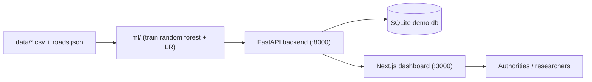

# AI-Based Disease Outbreak Prediction and Response Planner

An **academic end-to-end prototype** that predicts dengue high-incidence events
_one week in advance_ across 12 Indian cities, assesses severity, ranks regions
for response, recommends actions, and shows shortest logistics routes — with an
interactive web dashboard.

```
DEMO DATA - NOT FOR REAL-WORLD HEALTHCARE DECISIONS
```

All predictions, severity/priority scores, recommended actions and route maps are
computed from a **synthetically generated dataset** for demonstration purposes.
The "high-incidence event" label is a project-defined proxy for outbreak risk,
not an official epidemiological definition.

## What it does

- **Predicts** the probability (0–100%) that each region enters a high-incidence
  event next week, using a Random Forest trained on rolling/lag features
  (cases, growth, rainfall, temperature, humidity, water accumulation,
  seasonality, per-capita metrics).
- **Assesses severity** (LOW / MODERATE / HIGH / CRITICAL) from probability,
  case load, growth, deaths and geographic spread.
- **Ranks regions** with a weighted priority score (probability 50% · severity
  30% · population 20%) for resource allocation.
- **Plans a response:** 13 rule-based actions matched to severity bands, each
  with a human-readable, value-filled justification.
- **Routes logistics** with Dijkstra and A* over a demo road network (19 nodes,
  27 edges) and compares them side by side.
- **Explains** each prediction with perturbation-based feature attributions.

## Stack

| Layer | Technology |
| --- | --- |
| ML | Python · scikit-learn · pandas · joblib · matplotlib |
| Backend | FastAPI · uvicorn · SQLite (stdlib) |
| Frontend | Next.js 16 (App Router) · TypeScript · Tailwind · react-leaflet |
| Quality | pytest (19 tests) · ESLint · `tsc --noEmit` · `next build` |

## Quick start

```bash
# 1. Install dependencies
pip install -r backend/requirements.txt
npm install && cd frontend && npm install && cd ..

# 2. Train the model (once; regenerates ml/artifacts + ml/figures)
npm run train

# 3. Seed the database (once; creates backend/demo.db)
npm run seed

# 4. Run API (:8000) + dashboard (:3000)
npm run dev
```

Open **http://localhost:3000**. Full instructions, environment variables and
troubleshooting: [docs/setup.md](docs/setup.md).

## ML results (held-out test weeks)

| Model | Acc | Prec | Rec | F1 | ROC AUC | Role |
| --- | --- | --- | --- | --- | --- | --- |
| Logistic Regression | 0.737 | 0.324 | 0.918 | 0.479 | 0.901 | baseline |
| Random Forest (balanced) | 0.884 | 0.536 | 0.918 | 0.677 | 0.948 | evaluated variant |
| Random Forest (unweighted) | 0.922 | 0.778 | 0.571 | 0.659 | 0.952 | **serving model** |

The unweighted Random Forest serves predictions so probabilities reflect the
observed base rate of events (broad 0–93% dynamic range) instead of inflated
class-balanced shares.

## Dashboard pages

| Route | Content |
| --- | --- |
| `/dashboard` | national summary, critical alerts, interactive risk map |
| `/regions` | region list, priority ranking, per-region case history |
| `/predictions` | ranked predictions; detail page with explainability |
| `/predictions/[id]` | severity factors + recommended actions for one region |
| `/response` | recommended actions grouped by severity |
| `/routes` | Dijkstra vs A* logistics routing comparison |
| `/model` | ROC curves, confusion matrices, feature importance |
| `/data` | raw dataset browser + dataset info |

Architecture diagram: [docs/architecture.md](docs/architecture.md)

## System diagram



## Documentation

- [architecture.md](docs/architecture.md) — components, data flow, deployment
- [ml-methodology.md](docs/ml-methodology.md) — features, label, models, metrics
- [response-planning.md](docs/response-planning.md) — severity, priority, actions, routing
- [data-model.md](docs/data-model.md) — SQLite schema and lifecycle
- [api-reference.md](docs/api-reference.md) — all REST endpoints
- [setup.md](docs/setup.md) — install, run, verify, troubleshoot

## Reproducibility

- `scripts/generate_data.py` regenerates the synthetic dataset (deterministic).
- `npm run train` retrains and saves artifacts + figures.
- Seed is idempotent; the backend re-runs the prediction pipeline automatically
  on first request.
- Git-ignored runtime data (`backend/demo.db`, `ml/artifacts`, `ml/figures`,
  `node_modules`, `.next`) is rebuilt from the committed source and dataset.

## License / purpose

Built as an academic prototype for a course project. It is **not** medical
software and must not be used for real-world healthcare decisions.