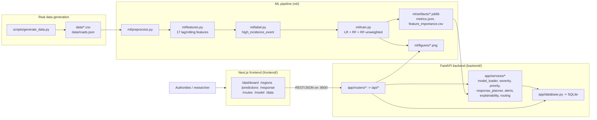
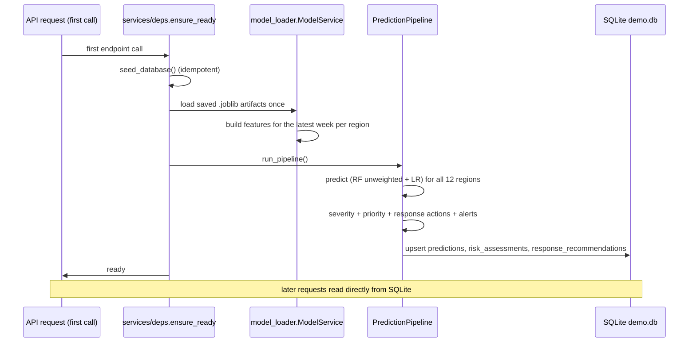

# System Architecture

The **AI-Based Disease Outbreak Prediction and Response Planner** is a full-stack
academic prototype made of four layers:

1. **real dataset generation** (`scripts/`)
2. **ML training pipeline** (`ml/`)
3. **FastAPI serving backend** (`backend/`)
4. **Next.js dashboard** (`frontend/`)

All data is synthetic and the UI always shows the disclaimer

## High-level diagram

## Prediction pipeline flow

The pipeline runs lazily on the first API request (`ensure_ready` in
`backend/app/services/deps.py`) and is guarded by a thread lock, so every
endpoint sees exactly the same persisted data.

## Components

### 1. Real data generation — `scripts/generate_data.py`

Creates a deterministic synthetic dengue surveillance dataset for 12 Indian
cities:

| File | Contents |
| --- | --- |
| `data/regions.csv` | 12 regions: id, name, lat/lon, population, density |
| `data/health_centers.csv` | 6 health centers linked to regions |
| `data/dengue_data.csv` | 188 weekly rows per region (2023-01-02 → 2026-08-03), 2,256 rows |
| `data/roads.json` | Road graph: 19 nodes, 27 edges with `distance_km` and `travel_time_min` |

### 2. ML pipeline — `ml/`

`train.py` produces the artifacts and figures the backend serves:

- `ml/artifacts/{model_lr, model_rf, model_rf_unweighted, scaler}.joblib`
- `ml/artifacts/metrics.json`, `ml/artifacts/feature_importance.csv`, `ml/artifacts/metadata.json`
- `ml/figures/{roc_curve, confusion_matrix_*, feature_importance}.png`

See [ML Methodology](ml-methodology.md) for details.

### 3. FastAPI backend — `backend/`

- `app/main.py` — app factory, CORS, static figure mounting, `/health`, `/docs`
- `app/routers/` — regions, predictions, recommendations, routes (Dijkstra/A*),
  model-info, dashboard
- `app/services/` — model loading, severity, priority, response planning, alerts,
  explainability, graph routing, pipeline orchestration
- `app/database.py` — SQLite schema + idempotent seed + upserts
- `app/db_conn.py` — shared connection dependency
- `tests/` — 19 pytest tests (API + routing)

### 4. Next.js dashboard — `frontend/`

Server-rendered pages that call the API from the browser (client components
via `useApi`) and render with react-leaflet maps and inline SVG charts.

| Route | Purpose |
| --- | --- |
| `/dashboard` | national summary, alerts, interactive risk map |
| `/regions` | region list, priority ranking, per-region history |
| `/predictions` | ranked outbreak predictions; detail page with explainability |
| `/predictions/[id]` | single-region detail + severity factors + recommendations |
| `/response` | recommended response actions grouped by severity |
| `/routes` | Dijkstra vs A* visual comparison on the road network |
| `/model` | model metrics, ROC / confusion matrices, feature importance |
| `/data` | raw dataset browser + dataset info |

## Configuration

Shared thresholds live in **one place** — `ml/config.py` (risk bands, severity
weights, priority weights, label definition). `backend/app/config.py` re-imports
them so training and serving can never drift apart.

Environment variables (see `.env.example`):

| Variable | Default | Used by |
| --- | --- | --- |
| `API_HOST` | `127.0.0.1` | backend bind address |
| `API_PORT` | `8000` | backend port |
| `DATABASE_PATH` | `backend/demo.db` | SQLite file |
| `ML_ARTIFACTS_DIR` | `ml/artifacts` | trained model files |
| `ML_FIGURES_DIR` | `ml/figures` | served matplotlib figures |
| `NEXT_PUBLIC_API_URL` | `http://127.0.0.1:8000` | frontend → API base URL |
| `DEMO_MODE` | `true` | watermark / disclaimer state |

## Ports & services

| Service | URL |
| --- | --- |
| Next.js dashboard | `http://localhost:3000` |
| FastAPI API | `http://127.0.0.1:8000` |
| OpenAPI docs (Swagger UI) | `http://127.0.0.1:8000/docs` |
| Model figures (static) | `http://127.0.0.1:8000/static/figures/*.png` |