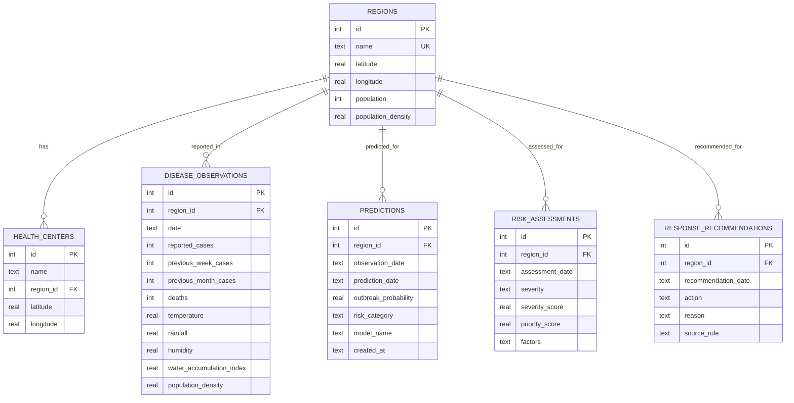

# Data Model

The backend persists the Real dataset and every computed prediction in a single
SQLite file, `backend/demo.db` (override with `DATABASE_PATH`). The file is
git-ignored and created/seeded automatically on first use.

## Entity-relationship diagram



## Tables

### `regions` (seeded)
`id`, `name` (unique), `latitude`, `longitude`, `population`,
`population_density`. Source: `data/regions.csv` (12 rows).

### `health_centers` (seeded)
`id`, `name`, `region_id` → `regions.id`, `latitude`, `longitude`.
Source: `data/health_centers.csv` (6 rows).

### `disease_observations` (seeded)
`id`, `region_id` → `regions.id`, `date`, `reported_cases`,
`previous_week_cases`, `previous_month_cases`, `deaths`, `temperature`,
`rainfall`, `humidity`, `water_accumulation_index`, `population_density`.
Unique on `(region_id, date)`. Source: `data/dengue_data.csv` (2,256 rows,
2023-01-02 → 2026-08-03). The CSV references the region by **name**, which the
seeder maps to `region_id` via a `name → id` lookup.

### `predictions` (computed)
`id`, `region_id`, `observation_date`, `prediction_date` (= observation + 1
week), `outbreak_probability`, `risk_category`, `model_name`,
`created_at`. Unique on `(region_id, prediction_date, model_name)`.

Two rows are written per region and date — one for each model:

- `Random Forest (serving)` — the unweighted RF probability (primary)
- `Logistic Regression (baseline)` — baseline probability for comparison

### `risk_assessments` (computed)
`id`, `region_id`, `assessment_date` (= prediction date), `severity`
(LOW/MODERATE/HIGH/CRITICAL), `severity_score` (0–1), `priority_score` (0–100),
`factors` (JSON string of the five severity sub-scores). Unique on
`(region_id, assessment_date)`.

### `response_recommendations` (computed)
`id`, `region_id`, `recommendation_date`, `action`, `reason`, `source_rule`
(rule id from `config.RESPONSE_RULES`). Unique on
`(region_id, recommendation_date, action)`.

## Seeding and lifecycle

`backend/app/database.py` exposes:

- `init_db()` — creates the schema (`CREATE TABLE IF NOT EXISTS`).
- `seed_database()` — **idempotent** seed using `INSERT OR IGNORE`; a second run
  inserts 0 rows. Returns per-table counts.
- Upsert helpers (`upsert_prediction`, `upsert_risk_assessment`,
  `upsert_recommendation`) — safe to re-run.
- `clear_prediction_assets()` — deletes all prediction/risk/recommendation rows
  so a fresh prediction run never accumulates stale weeks.

On the first API request, `services/deps.ensure_ready()` seeds the database (if
needed) and then runs `PredictionPipeline.persist()`, which calls
`clear_prediction_assets()` before writing the current week's results.

## Reproducing the database

```bash
# from the repository root
npm run seed     # -> cd backend && python -c "from app import database; print(database.seed_database())"
```

Or delete `backend/demo.db` and restart the backend — it is recreated and
seeded automatically.

## Source files

| File | Rows | Purpose |
| --- | --- | --- |
| `data/regions.csv` | 12 | region metadata |
| `data/health_centers.csv` | 6 | facility locations |
| `data/dengue_data.csv` | 2,256 | weekly surveillance observations |
| `data/roads.json` | 19 nodes / 27 edges | routing road graph (not stored in SQLite) |

The road graph is loaded directly from `data/roads.json` by
`services/routing/graph.py` at runtime.